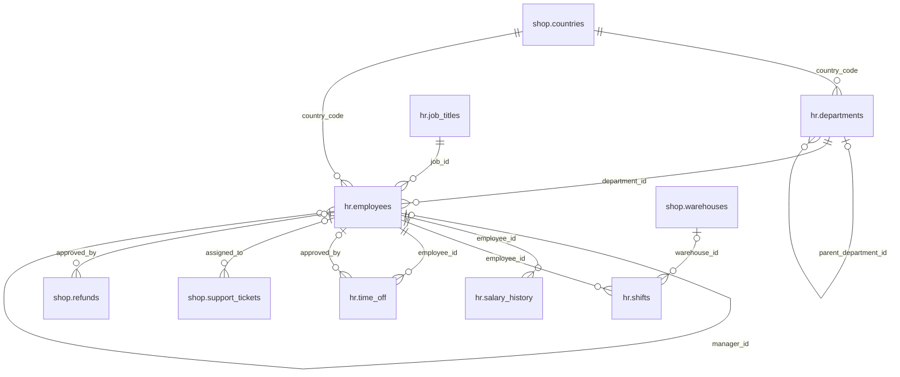
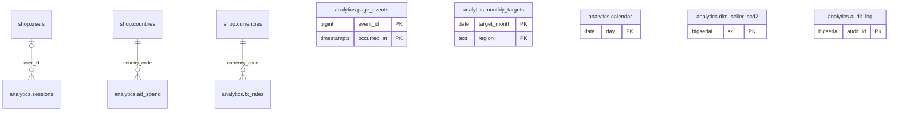

# query-practice

A self-contained PostgreSQL 17 lab for practising SQL from the basics up to
window functions, recursive CTEs, JSONB, partitioning and query tuning.

- **Realistic schema** — a marketplace: 30 tables across `shop`, `hr` and
  `analytics`, including a category tree, an org chart, JSONB attributes,
  `tsvector` full-text columns, `daterange` temporal tables with exclusion
  constraints, and a month-partitioned clickstream.
- **Reproducible data** — generated inside the database from deterministic
  hash functions. No dumps in git; same `SCALE` always yields the same rows.
- **288 exercises in 17 topics**, each with a reference answer, hints,
  difficulty and concept tags.
- **Automatic grading** — write your query, run `make diff`, get a row-level
  comparison against the reference result.

---

## Quick start

```bash
cp .env.example .env     # optional: change ports / SCALE
make build               # containers + schema + data   (~3 min at SCALE=1)
make list                # see the topics
make show Q=T05-03       # read one task
make new  Q=T05-03       # creates work/T05-03.sql
#   ... write your query in work/T05-03.sql ...
make diff Q=T05-03 F=work/T05-03.sql
```

- Postgres: `localhost:5433` (user `qp`, password `qp`, db `querypractice`)
- pgAdmin: <http://localhost:5050> — the server is pre-registered
- psql shell: `make psql`

## The practice loop

| Command | What it does |
|---|---|
| `make list` | topic overview with difficulty counts |
| `make list T=window` | list exercises of matching topics |
| `make show Q=T06-05` | task text, hint and concepts (no answer) |
| `make new Q=T06-05` | scaffold `work/T06-05.sql` with the task as a comment |
| `make diff Q=T06-05 F=work/T06-05.sql` | **grade**: compares your result set to the reference |
| `make answer Q=T06-05` | print the reference SQL |
| `make run Q=T06-05` | execute the reference SQL and show the rows |
| `make explain Q=T06-05` | `EXPLAIN (ANALYZE, BUFFERS, VERBOSE, SETTINGS)` |
| `make check` / `make check T=14` | run every reference answer (CI-style smoke test) |

Grading rules:

- Row order is ignored **unless** the reference query has an `ORDER BY`, in
  which case order must match.
- Column *names* are not compared, but column **count, order and values** are.
- Failures print the first differing rows on both sides.

## Topics

| # | Topic | Exercises |
|---|-------|-----------|
| 01 | Basics: SELECT, WHERE, NULL, ORDER BY, pagination | 16 |
| 02 | Joins: inner, outer, anti/semi, self, cross, LATERAL | 18 |
| 03 | Aggregation: GROUP BY, HAVING, FILTER, ordered-set aggregates | 18 |
| 04 | Subqueries & CTEs: correlated, EXISTS, materialization | 18 |
| 05 | Window functions I: ranking, lag/lead, frames (ROWS/RANGE/GROUPS) | 20 |
| 06 | Window functions II: gaps & islands, sessionisation, funnels, cohorts | 16 |
| 07 | Recursive CTEs: trees, graphs, paths, `SEARCH`/`CYCLE` | 16 |
| 08 | GROUPING SETS, ROLLUP, CUBE, pivot/unpivot, crosstab | 14 |
| 09 | JSONB: containment, jsonpath, building, GIN indexes | 20 |
| 10 | Arrays, ranges, multiranges, exclusion constraints | 18 |
| 11 | Text: LIKE, regex, full-text search, trigram, fuzzy matching | 18 |
| 12 | Dates, intervals, time zones, `date_bin`, time series | 16 |
| 13 | Set operations & data reconciliation | 12 |
| 14 | Performance: EXPLAIN, index types, sargability, partition pruning | 18 |
| 15 | DML: UPSERT, `UPDATE FROM`, MERGE, `SKIP LOCKED`, isolation | 16 |
| 16 | Data quality: profiling, dedup, validation, outliers | 16 |
| 17 | Capstone reports: RFM, LTV, basket analysis, attribution, SCD2 | 18 |

Full task text: [`exercises/README.md`](exercises/README.md).
Difficulty: 🟢 51 basic · 🟡 72 intermediate · 🟠 99 advanced · 🔴 66 expert.

## Dataset

`SCALE` in `.env` multiplies the fact tables. Defaults:

| SCALE | orders | order items | page events | DB size | seed time |
|---|---|---|---|---|---|
| 1 (default) | 250 k | ~750 k | 2 M | ~1.1 GB | ~3 min |
| 5 | 1.25 M | ~3.7 M | 10 M | ~5 GB | ~15 min |
| 20 | 5 M | ~15 M | 40 M | ~20 GB | ~1 h |

```bash
make reset SCALE=5       # wipe volumes and rebuild bigger
```

Data properties that exercises rely on: NULLs in optional columns, ~12 % of
products never sold, skewed (Zipf) customer and product popularity, failed
payment retries, partial refunds, threaded reviews and support messages,
deliberate gaps in FX rates and shift calendars, and a dirty
`shop.raw_leads` staging table.

See [`docs/schema.md`](docs/schema.md) for the full ER description and
[`docs/learning-path.md`](docs/learning-path.md) for a suggested order.

## Data model (ERD)

These diagrams show the base tables and declared foreign keys in
[`db/schema/`](db/schema/). Relationship labels name the foreign-key column
on the child table. `||` means exactly one parent, `o|` / `|o` means an
optional parent, and `o{` means zero or more children. Lines show foreign
keys; identifying versus non-identifying relationships is not distinguished.
Tables without foreign keys show their primary keys instead.

### Marketplace (`shop`)

```mermaid
erDiagram
    "shop.categories" |o--o{ "shop.categories" : parent_id
    "shop.countries" ||--o{ "shop.users" : country_code
    "shop.users" |o--o{ "shop.users" : referred_by
    "shop.users" ||--o{ "shop.user_addresses" : user_id
    "shop.countries" ||--o{ "shop.user_addresses" : country_code
    "shop.countries" ||--o{ "shop.sellers" : country_code
    "shop.sellers" |o--o{ "shop.sellers" : parent_seller_id
    "shop.sellers" |o--o{ "shop.warehouses" : seller_id
    "shop.countries" ||--o{ "shop.warehouses" : country_code
    "shop.sellers" ||--o{ "shop.products" : seller_id
    "shop.categories" ||--o{ "shop.products" : category_id
    "shop.currencies" ||--o{ "shop.products" : currency_code
    "shop.products" ||--o{ "shop.product_variants" : product_id
    "shop.warehouses" ||--o{ "shop.inventory" : warehouse_id
    "shop.product_variants" ||--o{ "shop.inventory" : variant_id
    "shop.product_variants" ||--o{ "shop.price_history" : variant_id
    "shop.promotions" ||--o{ "shop.promotion_categories" : promo_id
    "shop.categories" ||--o{ "shop.promotion_categories" : category_id
    "shop.users" |o--o{ "shop.carts" : user_id
    "shop.carts" ||--o{ "shop.cart_items" : cart_id
    "shop.product_variants" ||--o{ "shop.cart_items" : variant_id
    "shop.users" ||--o{ "shop.orders" : user_id
    "shop.currencies" ||--o{ "shop.orders" : currency_code
    "shop.user_addresses" |o--o{ "shop.orders" : ship_address_id
    "shop.promotions" |o--o{ "shop.orders" : promo_id
    "shop.orders" ||--o{ "shop.order_items" : order_id
    "shop.product_variants" ||--o{ "shop.order_items" : variant_id
    "shop.products" ||--o{ "shop.order_items" : product_id
    "shop.sellers" ||--o{ "shop.order_items" : seller_id
    "shop.warehouses" |o--o{ "shop.order_items" : fulfilled_from_warehouse
    "shop.orders" ||--o{ "shop.payments" : order_id
    "shop.currencies" ||--o{ "shop.payments" : currency_code
    "shop.payments" ||--o{ "shop.refunds" : payment_id
    "shop.order_items" |o--o{ "shop.refunds" : order_item_id
    "shop.orders" ||--o{ "shop.shipments" : order_id
    "shop.shipments" ||--o{ "shop.shipment_items" : shipment_id
    "shop.order_items" ||--o{ "shop.shipment_items" : order_item_id
    "shop.products" ||--o{ "shop.reviews" : product_id
    "shop.users" ||--o{ "shop.reviews" : user_id
    "shop.order_items" |o--o{ "shop.reviews" : order_item_id
    "shop.reviews" |o--o{ "shop.reviews" : reply_to
    "shop.users" ||--o{ "shop.wishlist_items" : user_id
    "shop.products" ||--o{ "shop.wishlist_items" : product_id
    "shop.users" ||--o{ "shop.support_tickets" : user_id
    "shop.orders" |o--o{ "shop.support_tickets" : order_id
    "shop.support_tickets" ||--o{ "shop.ticket_messages" : ticket_id
    "shop.ticket_messages" |o--o{ "shop.ticket_messages" : parent_message_id
    "shop.orders" |o--o{ "shop.carts" : converted_order_id
    "shop.raw_leads" {
        bigserial raw_id PK
    }
```



### People and operations (`hr`)

Includes the cross-schema links for support assignments and refund approvals.



### Analytics (`analytics`)



`page_events` is partitioned by `occurred_at`; its monthly and default
partitions are omitted. Its `session_id`, `user_id`, `product_id`, and
`country_code` are logical join keys, **not enforced foreign keys**.
Likewise, `dim_seller_scd2.seller_id` and `country_code` have no foreign-key
constraints. Views, materialized views, and `practice` helpers are omitted;
see [`docs/schema.md`](docs/schema.md) for details.

## Performance work

The shipped index set in `db/schema/06_indexes.sql` is deliberately
incomplete. Topic 14 asks you to find what is missing:

```bash
make explain Q=T14-07    # plan before
make indexes             # applies db/perf/optional_indexes.sql
make explain Q=T14-07    # plan after
```

Reset to the original index set with `make schema seed` (or `make reset`).

## Layout

```
db/schema/        DDL: extensions, tables, views, indexes
db/seed/          deterministic data generation (00..06)
db/maintenance/   matviews, extended statistics, size report
db/perf/          the "discover these yourself" indexes
solutions/        reference answers + task metadata (source of truth)
exercises/        generated markdown (make exercises)
scripts/qp.py     the CLI behind every make target
work/             your attempts (git-ignored)
config/           postgresql.conf used by the container
```

## Requirements

Docker with Compose v2, GNU make, Python 3.8+ (standard library only).
No local Postgres client needed — `psql` runs inside the container.
